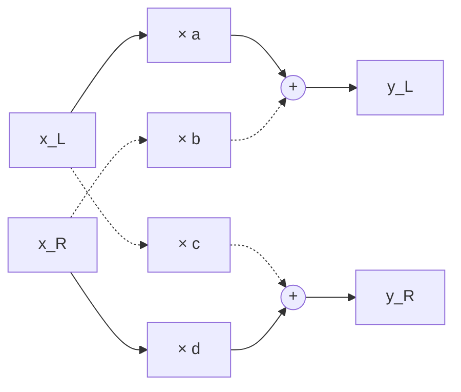

# Stereo panning

How a sound is placed between two speakers, from a mono pan to a true stereo pan with width and position, with the `stereo-pan` plugin as the example.

## What you will learn

- **Stereo image:** where sound sources are heard between two speakers
- **Pan law:** how the two speaker gains follow the pan position
- **Mono pan, balance, true stereo pan:** three ways to pan, and what each can move
- **Width and position:** a natural control on top of a true stereo pan
- **What constant power guarantees:** per input channel, not for the sum
- **Smoothing across blocks:** why the gain ramps carry state

| Symbol             | Meaning                                                     | Unit                 |
| ------------------ | ----------------------------------------------------------- | -------------------- |
| `x_L`, `x_R`       | Left and right input sample                                 | sample value         |
| `y_L`, `y_R`       | Left and right output sample                                | sample value         |
| `p`                | Pan position, −1 = fully left, 0 = center, +1 = fully right | none                 |
| `θ`                | Pan angle, 0 = fully left, π/2 = fully right                | rad                  |
| `g_L`, `g_R`       | Gains of a mono source into the left and right output       | none (linear factor) |
| `a`, `b`, `c`, `d` | Gains of the 2×2 mix (see below)                            | none (linear factor) |
| `w`                | Width, 0 = mono, 1 = original image                         | none                 |

## Stereo image

- Two speakers playing the same signal at the same level make the listener hear one source in the middle, although no speaker is there: a **phantom image**.
- A level difference between the channels moves the image toward the louder speaker; so does a small time difference. Panning uses level only.
- The **stereo image** is the left-to-right placement of all sources a listener perceives.

## Pan law

A mono source `x` is placed with two gains: `y_L = g_L(p) · x`, `y_R = g_R(p) · x`. The pan law is the rule `p → (g_L, g_R)`; it mainly decides how loud the source is at the center compared with fully left or right.

| Pan law                  | Gains                                | Each gain at center | Perceived                                    |
| ------------------------ | ------------------------------------ | ------------------- | -------------------------------------------- |
| Linear                   | `g_L = (1 − p)/2`, `g_R = (1 + p)/2` | 0.5 (−6 dB)         | quieter in the middle                        |
| Constant power (sin/cos) | `g_L = cos θ`, `g_R = sin θ`         | 0.707 (−3 dB)       | roughly even loudness across the whole sweep |
| −4.5 dB compromise       | geometric mean of the two above      | 0.596 (−4.5 dB)     | in between; found on some consoles           |

with `θ = π/4 · (p + 1)`. Constant power keeps `g_L² + g_R² = 1`: two speakers playing uncorrelated sound add their powers, so the acoustic power stays the same at every position. Linear keeps `g_L + g_R = 1`, which is correct only where the two signals add as amplitudes (close to mono summing).

**stereo-pan:** constant power.

## Three ways to pan

**Mono pan:** one input, two outputs, two gains. The source can be placed anywhere.

**Balance:** two inputs, each scaled on its own (`y_L = g_L · x_L`, `y_R = g_R · x_R`). Turning right only lowers the left channel; content in the left channel fades out instead of moving.

**True stereo pan:** each output is a weighted sum of both inputs, so content can cross sides:

`a`: left → left, `b`: right → left, `c`: left → right, `d`: right → right. Balance is the special case `b = c = 0`; the dashed cross paths are what makes it a true stereo pan.

## Designs for a true stereo pan

| Design              | Parameters   | How the four gains are set                                                                                         |
| ------------------- | ------------ | ------------------------------------------------------------------------------------------------------------------ |
| One knob, narrowing | `p`          | Center leaves the image unchanged; toward a side, the far input moves across until both inputs sit in one speaker. |
| Dual pan            | `p_L`, `p_R` | Each input gets its own mono pan with the pan law: `(a, c)` from `p_L`, `(b, d)` from `p_R`.                       |
| Width and position  | `w`, `p`     | A front end to dual pan: `p_L = p − w`, `p_R = p + w`.                                                             |

- Dual pan and width/position produce **the same gains** for corresponding settings and therefore sound identical. They differ in how they are operated.
- Dual pan needs two knobs to move the image, and easily reaches odd settings (`p_L = +1`, `p_R = −1` swaps the sides).
- Width and position separate the two perceptual questions, "how wide" and "where".
- Width and position need an **edge rule**: `w = 1`, `p = 0.5` would give `p_R = 1.5`. Clamping `p_L`, `p_R` to ±1 shifts the image center away from `p`; limiting the width, `w_eff = min(w, 1 − |p|)`, keeps the center exactly at `p`.

**stereo-pan:** width and position, with the width limit, on top of dual pan with constant power.

## What constant power guarantees

The total output power of the 2×2 mix is

$$y_L^2 + y_R^2 = (a^2 + c^2)\,x_L^2 + (b^2 + d^2)\,x_R^2 + 2(ab + cd)\,x_L x_R$$

- Constant power fixes the first two terms: each input channel keeps its own power, `a² + c² = b² + d² = 1`.
- The last term depends on the signal. It vanishes for all inputs only if `ab + cd = cos(θ_L − θ_R) = 0`, i.e. at full width with the image unchanged.
- As soon as both inputs share a side, the sum depends on how alike they are: identical inputs get louder (in one channel up to +6 dB in amplitude), uncorrelated inputs keep their total power, opposite-polarity inputs cancel.
- No fixed-gain panner avoids this; a mixing console behaves the same when two microphones are panned to one spot.

## Smoothing across blocks

- The host does not pass the audio sample by sample but in **blocks**: each call of `processBlock` carries `B` samples per channel (for example 64, 512, 1024). The host chooses `B`, may change it between calls, and announces only its maximum in `prepareToPlay`.
- A 20 ms ramp is 960 samples at 48 kHz and therefore runs over many blocks. The smoother has to keep its state (current value, target, remaining steps) between calls; otherwise errors appear only at certain block sizes. pluginval tests several block sizes for this reason.
- A parameter change during a running ramp has to start from the current value, not from the old target; otherwise the gain jumps and clicks.
- The ramp length in samples, `N = round(T · f_s)` with ramp time `T` in s and sample rate `f_s` in Hz, depends on the sample rate and is recomputed on prepare.
- The four gains are ramped linearly, not the angles. Between two points on the circle `a² + c² = 1`, the straight line runs inside it, so mid-ramp the power per input dips, by at most `cos(π/4)` = −3 dB for a jump from one side to the other. For a few milliseconds this is inaudible; it saves computing `sin` and `cos` per sample.

## Measuring a 2×2 mix

- An impulse on both inputs at once only shows `a + b` and `c + d`. Feeding the left input alone gives `a` and `c`; the right input alone gives `b` and `d`.
- The test checks the implementation against fixed numbers in the spec, not against the formulas recomputed in the test (a formula error would then be invisible).
- Typical errors it catches: `b` and `c` swapped, the normalised host value not mapped back to −1 … +1, the width limit missing, and the **in-place error**: JUCE processes the buffer in place, so writing `y_L` into the left channel before computing `y_R` uses an already overwritten `x_L`.
- Expected values of 0 need an absolute tolerance: `cos(π/2)` is not exactly 0 in floating point.
