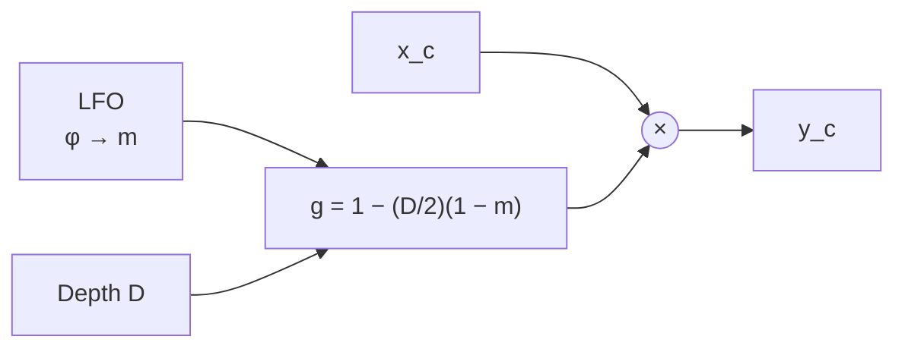

# LFO and amplitude modulation

A low-frequency oscillator (LFO) as a source that moves a parameter over time, and amplitude modulation as its simplest use: the LFO moves the gain. The `tremolo` plugin serves as the example.

Builds on: [decibels-and-parameter-smoothing.md](decibels-and-parameter-smoothing.md)

## What you will learn

- How an LFO generates a periodic control signal from a phase accumulator
- How range, polarity, and depth map the LFO output onto a parameter
- What amplitude modulation does to the spectrum, and when it is heard as pulsing
- Why depth is smoothed and rate is not
- How the expected test values follow from the gain mapping

## Key concepts

- **LFO:** oscillator below the audio range, used as a control signal, not as sound. Transferable: phaser, chorus, flanger, auto-pan, vibrato.
- **Phase accumulator:** a counter that wraps at 1 and serves as the time base of the oscillator. Transferable: every oscillator, wavetable reading.
- **Modulation mapping:** range, polarity, and depth that turn the LFO output into a parameter value. Transferable: every modulated parameter.
- **Amplitude modulation (AM):** a gain that varies in time; it adds sidebands at the modulation frequency around every input frequency. Transferable: ring modulation, the clicks that smoothing prevents.

## Symbols

| Symbol             | Meaning                                                    | Unit                 |
| ------------------ | ---------------------------------------------------------- | -------------------- |
| $n$                | Sample index (time)                                        | none                 |
| $t$                | Continuous time, $t = n/f_s$                               | s                    |
| $x_c$, $y_c$       | Input and output sample of channel $c$                     | sample value         |
| $f_s$              | Sample rate                                                | Hz                   |
| $f_\text{LFO}$     | LFO frequency (rate)                                       | Hz                   |
| $\Delta\varphi$    | Phase increment per sample, $f_\text{LFO}/f_s$             | cycles per sample    |
| $\varphi$          | LFO phase, $0 \le \varphi < 1$                             | cycles               |
| $m$                | LFO output, bipolar, $-1 … 1$                              | none                 |
| $u$                | LFO output, unipolar, $0 … 1$                              | none                 |
| $D$                | Depth, $0 … 1$                                             | none                 |
| $g$                | Gain factor applied to the signal                          | none (linear factor) |
| $v_\text{min}$, $v_\text{max}$ | Lower and upper end of the modulation range    | unit of the parameter |
| $f_0$, $a_0$       | Frequency and amplitude of a sinusoidal test input         | Hz, sample value     |
| $T$                | Ramp time of the smoother                                  | s                    |
| $N$                | Ramp length                                                | samples              |

## LFO

An LFO runs at roughly 0.02 to 20 Hz. Its time base is a phase accumulator that advances by a constant increment and wraps at 1:

$$\Delta\varphi = \frac{f_\text{LFO}}{f_s}, \qquad \varphi[n+1] = \bigl(\varphi[n] + \Delta\varphi\bigr) \bmod 1$$

The phase is unipolar; every waveform is a function of it. A sine is $m = \sin(2\pi\varphi)$, a bipolar sawtooth $m = 2\varphi - 1$, and a triangle follows from the sawtooth as $m = 2|2\varphi - 1| - 1$. One time base thus serves all waveforms, and a second accumulator offset by $0.25$ gives the same waveform shifted by 90° (quadrature phase), which stereo effects use for the second channel.

Pirkle replaces $\sin$ by an approximation built from two parabolas to save computing time. It is continuously differentiable, but its second derivative with respect to the angle jumps at every zero crossing, from $-1/\pi^2$ to $+1/\pi^2$, where the exact sine has $\sin'' = 0$. As a control signal at a few hertz the difference is inaudible; it only matters when test values are derived from the exact sine.

The rate is perceived by ratio, like any frequency, so its parameter gets a skewed mapping ([parameter scaling](decibels-and-parameter-smoothing.md#parameter-scaling)).

**tremolo:** sine only, computed exactly. One LFO serves all channels, held in double precision, and prepare and reset set $\varphi = 0$. Rate is $0.1 … 20$ Hz with a logarithmic mapping.

## Range, polarity, and depth

An LFO moves a parameter between two limits $v_\text{min}$ and $v_\text{max}$. With the unipolar output $u = (m + 1)/2$, there are three common mappings:

| Mapping            | Parameter value                                              | Center of the movement     |
| ------------------ | ------------------------------------------------------------ | -------------------------- |
| Unipolar, min-up   | $v_\text{min} + D\,u\,(v_\text{max} - v_\text{min})$         | rises with $D$             |
| Unipolar, max-down | $v_\text{max} - D\,(1 - u)\,(v_\text{max} - v_\text{min})$   | falls with $D$             |
| Bipolar, centered  | $\tfrac{1}{2}(v_\text{min} + v_\text{max}) + D\,m\,\tfrac{1}{2}(v_\text{max} - v_\text{min})$ | fixed |

At $D = 1$ all three sweep the full range; they differ in what $D < 1$ does. For a gain, max-down is the natural choice: at $D = 0$ the signal passes unchanged, and more depth only attenuates.

**tremolo:** max-down with $v_\text{min} = 0$, $v_\text{max} = 1$:

$$g[n] = 1 - D\,\bigl(1 - u[n]\bigr) = 1 - \frac{D}{2}\bigl(1 - m[n]\bigr) \in [1 - D,\ 1], \qquad y_c[n] = g[n]\,x_c[n]$$

## Amplitude modulation

A product in time is a convolution in frequency ([parameter smoothing](decibels-and-parameter-smoothing.md#parameter-smoothing)). For a sine input $x = a_0\cos(2\pi f_0 t)$ and $m = \sin(2\pi f_\text{LFO} t)$, the tremolo output is

$$y = a_0\Bigl(1 - \frac{D}{2}\Bigr)\cos(2\pi f_0 t) + \frac{a_0 D}{4}\Bigl[\sin\bigl(2\pi(f_0 + f_\text{LFO})t\bigr) - \sin\bigl(2\pi(f_0 - f_\text{LFO})t\bigr)\Bigr]$$

The carrier keeps a share $1 - D/2$, and two sidebands of amplitude $a_0 D/4$ appear at $f_0 \pm f_\text{LFO}$. Whether this is heard as a moving level or as new tones depends on their spacing. Below about 15 Hz the ear cannot resolve the sidebands and follows the envelope: the level pulses. Above about 20 Hz the sidebands become separate components, first as roughness, then as audible tones, which is the sound of ring modulation. The upper end of the rate range is set by this limit.

The mean gain is $\bar g = 1 - D/2$, so a tremolo always makes the signal quieter on average; at $D = 1$ the mean amplitude drops by half, $20\log_{10} 0.5 \approx -6$ dB.

**tremolo:** rate up to 20 Hz, where pulsing turns into roughness.

## Smoothing depth, not rate

A jump of the depth by $\Delta D$ jumps the gain by

$$\Delta g = -\frac{\Delta D}{2}\bigl(1 - m[n]\bigr), \qquad |\Delta g| \le |\Delta D|$$

which is a step in $g$ and clicks like any gain jump. Depth is therefore ramped linearly over $N = \operatorname{round}(T f_s)$ samples. A change of the rate only changes $\Delta\varphi$; the phase continues from its current value, so $m$ and $g$ stay continuous and only their slope changes. Rate needs no smoother.

**tremolo:** $D$ ramps linearly with $T = 20$ ms; prepare and reset set it to the target without a ramp. $f_\text{LFO}$ is not smoothed.

## Measuring

An impulse shows only $g[0]$, because the system is time-variant. A constant input $x_c[n] = 1$ gives $y_c[n] = g[n]$ and makes the whole modulation visible. With $f_s = 48$ kHz and $f_\text{LFO} = 5$ Hz, one period has $f_s/f_\text{LFO} = 9600$ samples and $\varphi[n] = n/9600$. The quarter points give $m = 0, 1, 0, -1, 0$ at $n = 0, 2400, 4800, 7200, 9600$, and so

$$g = 1 - \tfrac{D}{2},\ \ 1,\ \ 1 - \tfrac{D}{2},\ \ 1 - D,\ \ 1 - \tfrac{D}{2}$$

which for $D = 0.5$ is $0.75, 1, 0.75, 0.5, 0.75$. Typical errors this catches: the phase reset per block instead of carried across blocks (the result changes with the block size), the increment computed in cycles instead of radians or the reverse, min-up instead of max-down (the maximum is no longer 1), and the shared LFO advanced once per channel instead of once per sample (the period is halved in stereo). $D = 0$ must give $g = 1$ exactly, so the signal passes bit-exact.

The increment $1/9600$ is not exact in binary floating point; after $n$ steps the phase error grows to about $n$ times the rounding error of one addition, near $10^{-12}$ after one period in double precision, far below the tolerance.

## Summary

- An LFO is a phase accumulator $\varphi[n+1] = (\varphi[n] + f_\text{LFO}/f_s) \bmod 1$ followed by a waveform; one time base serves every waveform and every phase offset.
- Range, polarity, and depth map the LFO output onto a parameter; for a gain, max-down $g = 1 - \tfrac{D}{2}(1 - m)$ leaves the signal unchanged at $D = 0$ and only attenuates.
- Amplitude modulation adds sidebands of amplitude $a_0 D/4$ at $f_0 \pm f_\text{LFO}$; below about 15 Hz the ear hears them as a pulsing level, above about 20 Hz as roughness or tones.
- Depth jumps step the gain and must be ramped; rate changes only change the slope of a continuous phase and need no smoothing.
- A constant input turns the output into $g[n]$, whose quarter-period values follow directly from the mapping.

## References

- Pirkle, "Designing Audio Effect Plugins in C++", Ch. 13.1 (LFO algorithms, Eq. 13.1 and 13.2, `parabolicSine`), 13.1.5 (`LFO::reset`, `LFO::renderAudioOutput`), 13.3.1 (modulation range, polarity, and depth), 13.8 (homework: tremolo, Figure 13.15)
- [decibels-and-parameter-smoothing.md](decibels-and-parameter-smoothing.md)
- [plugins/tremolo/spec.md](../../plugins/tremolo/spec.md)
