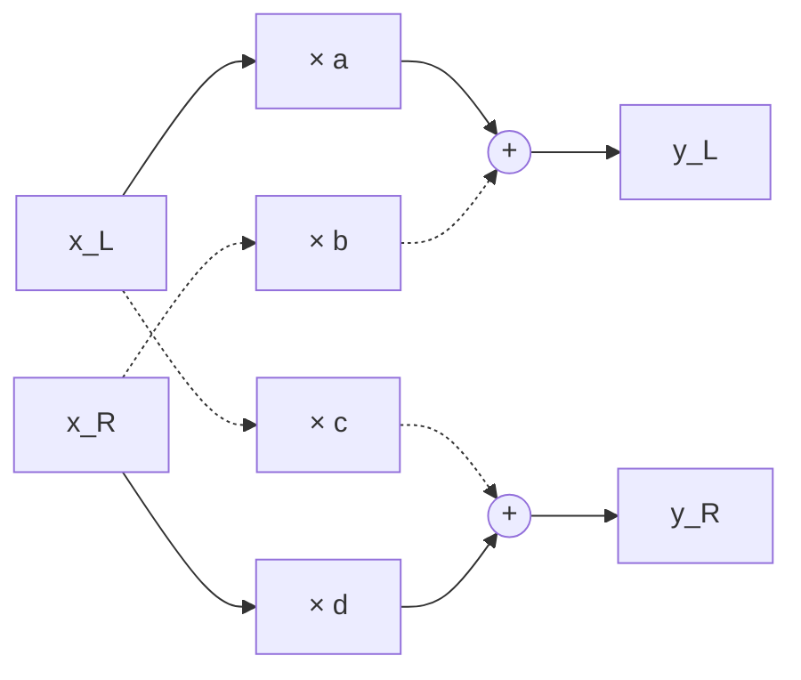

# Stereo panning

How a sound is placed between two speakers: pan laws for a mono source, and the 2×2 mix that pans a stereo signal with width and position. The `stereo-pan` plugin serves as the example.

Builds on: [decibels-and-parameter-smoothing.md](decibels-and-parameter-smoothing.md)

## What you will learn

- How level differences between two speakers create a stereo image
- How a pan law sets the two gains of a mono source, and why constant power keeps the loudness even
- How mono pan, balance, and true stereo pan differ, and what each can move
- How width and position control a true stereo pan
- What constant power guarantees for a 2×2 mix, and what it does not
- Why the four gains are ramped instead of the angles, and what that costs
- How the expected test values follow from the gain mapping

## Key concepts

- **Phantom image:** a source heard between two speakers, where no speaker is.
- **Pan law:** rule from the pan position to the two gains of a mono source. Transferable: auto-pan, ping-pong delay, every mixer channel.
- **Constant power:** gains with $g_L^2 + g_R^2 = 1$. Transferable: crossfades, dry/wet mix.
- **2×2 mix:** each output is a weighted sum of both inputs. Transferable: mid/side processing, cross-feedback in a ping-pong delay.
- **Width and position:** a front end that sets the pan of both inputs from two perceptual controls.

## Symbols

| Symbol                     | Meaning                                                                         | Unit                 |
| -------------------------- | ------------------------------------------------------------------------------- | -------------------- |
| $x$                        | Sample of a mono source                                                         | sample value         |
| $x_L$, $x_R$               | Left and right input sample                                                     | sample value         |
| $y_L$, $y_R$               | Left and right output sample                                                    | sample value         |
| $n$                        | Sample index (time)                                                             | none                 |
| $\delta[n]$                | Unit impulse, $1$ at $n = 0$ and $0$ elsewhere                                  | sample value         |
| $p$                        | Pan position, $-1$ fully left, $0$ center, $+1$ fully right                     | none                 |
| $\theta$                   | Pan angle, $\theta = \tfrac{\pi}{4}(p + 1)$, $0$ fully left, $\pi/2$ fully right | rad                  |
| $g_L$, $g_R$               | Gains of a mono source into the left and right output                           | none (linear factor) |
| $a$, $b$, $c$, $d$         | Gains of the 2×2 mix (see below)                                                | none (linear factor) |
| $p_L$, $p_R$               | Pan positions of the left and right input                                       | none                 |
| $\theta_L$, $\theta_R$     | Pan angles of the left and right input                                          | rad                  |
| $w$                        | Width, $0$ mono, $1$ original image                                             | none                 |
| $w_\text{eff}$             | Width after the edge rule                                                       | none                 |
| $L$                        | Level of a gain factor $g$, $L = 20 \log_{10} g$                                | dB                   |
| $\Delta\theta$             | Angle between the start and the target of a ramp                                | rad                  |
| $T$                        | Ramp time                                                                       | s                    |
| $f_s$                      | Sample rate                                                                     | Hz                   |
| $N$                        | Ramp length                                                                     | samples              |

## Stereo image

Two speakers that play the same signal at the same level make the listener hear one source in the middle, although no speaker is there: a phantom image. A level difference between the channels moves the image toward the louder speaker, and so does a small time difference; panning uses level only. The stereo image is the left-to-right placement of all sources that a listener perceives.

**stereo-pan:** moves and narrows the image of a stereo signal, by level only.

## Pan law

A mono source $x$ is placed with two gains,

$$y_L = g_L(p)\,x, \qquad y_R = g_R(p)\,x$$

The pan law is the rule $p \mapsto (g_L, g_R)$. It mainly decides how loud the source is at the center compared with fully left or right. The level of a gain is $L = 20 \log_{10} g$ (derived in [decibels-and-parameter-smoothing.md](decibels-and-parameter-smoothing.md#decibel-scale)). Three laws are common:

| Pan law            | $g_L$                             | $g_R$                             | Each gain at center | Perceived                              |
| ------------------ | --------------------------------- | --------------------------------- | ------------------- | -------------------------------------- |
| Linear             | $\tfrac{1-p}{2}$                  | $\tfrac{1+p}{2}$                  | $0.5$ ($-6$ dB)     | quieter in the middle                  |
| Constant power     | $\cos\theta$                      | $\sin\theta$                      | $0.707$ ($-3$ dB)   | roughly even loudness across the sweep |
| −4.5 dB compromise | $\sqrt{\tfrac{1-p}{2}\cos\theta}$ | $\sqrt{\tfrac{1+p}{2}\sin\theta}$ | $0.596$ ($-4.5$ dB) | in between; found on some consoles     |

with $\theta = \tfrac{\pi}{4}(p + 1)$. The compromise is the geometric mean of the other two. Constant power keeps

$$g_L^2 + g_R^2 = \cos^2\theta + \sin^2\theta = 1$$

Two speakers that play uncorrelated sound add their powers at the listener, so the acoustic power is the same at every position. The linear law keeps $g_L + g_R = 1$ instead, which is right only where the two signals add as amplitudes, as when they are summed to mono.

**stereo-pan:** constant power.

## Three ways to pan

A mono pan has one input, two outputs, and two gains; it can place the source anywhere. A stereo signal has two inputs, and the general form is a 2×2 mix in which each output is a weighted sum of both inputs:

$$\begin{bmatrix} y_L \\ y_R \end{bmatrix} = \begin{bmatrix} a & b \\ c & d \end{bmatrix} \begin{bmatrix} x_L \\ x_R \end{bmatrix}$$

Here $a$ is the path left → left, $b$ right → left, $c$ left → right, and $d$ right → right.

Balance is the special case $b = c = 0$: each input is only scaled, $y_L = a\,x_L$ and $y_R = d\,x_R$. Turning right lowers only the left channel, so content in the left channel fades out instead of moving. A true stereo pan uses the cross paths $b$ and $c$ (dashed), so content can cross sides.

**stereo-pan:** a true stereo pan; it accepts only stereo in and stereo out.

## Width and position

A true stereo pan has three common designs:

| Design              | Parameters     | How the four gains are set                                                                                          |
| ------------------- | -------------- | ------------------------------------------------------------------------------------------------------------------- |
| One knob, narrowing | $p$            | At the center the image is unchanged; toward a side, the far input moves across until both inputs sit in one speaker. |
| Dual pan            | $p_L$, $p_R$   | Each input gets its own mono pan with the pan law.                                                                  |
| Width and position  | $w$, $p$       | A front end to dual pan: $p_{L,R} = p \mp w$.                                                                       |

For dual pan with the constant-power law, each input has its own angle $\theta_{L,R} = \tfrac{\pi}{4}(p_{L,R} + 1)$ and its own pair of gains:

$$a = \cos\theta_L, \quad c = \sin\theta_L, \qquad b = \cos\theta_R, \quad d = \sin\theta_R$$

Dual pan and width/position produce the same gains for corresponding settings and therefore sound identical; they differ in how they are operated. Dual pan needs two knobs to move the image and easily reaches odd settings: $p_L = +1$, $p_R = -1$ swaps the sides. Width and position separate the two perceptual questions, how wide and where.

Width and position need an edge rule, because $w = 1$, $p = 0.5$ would give $p_R = 1.5$. Clamping $p_L$ and $p_R$ to $\pm 1$ changes only one of them, so the image center $(p_L + p_R)/2$ drifts away from $p$ (here to $0.25$). Limiting the width instead,

$$w_\text{eff} = \min(w,\, 1 - |p|), \qquad p_{L,R} = p \mp w_\text{eff}$$

keeps both positions inside $[-1, 1]$ and the center exactly at $p$.

**stereo-pan:** width and position with the width limit, on top of dual pan with constant power.

## What constant power guarantees

The total output power of the 2×2 mix is

$$y_L^2 + y_R^2 = (a^2 + c^2)\,x_L^2 + (b^2 + d^2)\,x_R^2 + 2(ab + cd)\,x_L x_R$$

Constant power fixes the first two terms, $a^2 + c^2 = b^2 + d^2 = 1$, so each input channel keeps its own power. The cross term depends on the signal. With the dual-pan gains,

$$ab + cd = \cos\theta_L \cos\theta_R + \sin\theta_L \sin\theta_R = \cos(\theta_L - \theta_R)$$

which vanishes only for $\theta_R - \theta_L = \pi/2$, that is $p_L = -1$ and $p_R = +1$: full width with the image unchanged. As soon as both inputs share a side, the sum depends on how alike they are. Identical inputs get louder; in the extreme case $x_L = x_R = x$, $w = 1$, $p = 1$, the gains are $c = d = 1$ and

$$y_R = (c + d)\,x = 2x, \qquad L = 20 \log_{10} 2 \approx +6\ \text{dB}$$

Uncorrelated inputs keep their total power, because $x_L x_R$ averages to zero, and inputs of opposite polarity cancel. No panner with fixed gains avoids this; a mixing console behaves the same when two microphones are panned to one spot.

**stereo-pan:** with correlated inputs on one side the output can reach $+6$ dB above the input; the plugin does not clip.

## Smoothing the four gains

Each parameter change ramps the coefficients linearly over $N = \operatorname{round}(T f_s)$ samples. The ramp keeps its state across processing blocks and starts from the current value when the target changes during a ramp; the reasons and the derivation are in [decibels-and-parameter-smoothing.md](decibels-and-parameter-smoothing.md#parameter-smoothing).

Specific to panning is the choice of what to ramp. Ramping the four gains linearly instead of the angles saves computing $\sin$ and $\cos$ per sample, but the gains of one input then leave the unit circle $a^2 + c^2 = 1$ and move along the chord between start and target. At the middle of a ramp across the angle $\Delta\theta$, the gain magnitude per input is

$$\sqrt{a^2 + c^2}\,\Big|_\text{mid} = \cos\frac{\Delta\theta}{2}$$

The largest jump, from one side to the other, has $\Delta\theta = \pi/2$ and dips to $\cos(\pi/4) = 0.707$, that is $-3$ dB, for a moment. Within a ramp of a few tens of milliseconds this is inaudible.

**stereo-pan:** $a$, $b$, $c$, $d$ ramp linearly with $T = 20$ ms. Prepare and reset set them to their targets without a ramp, and so does loading a saved state.

## Measuring

An impulse on both inputs at once shows only the sums $a + b$ and $c + d$. Feeding one input at a time separates the four gains: $x_L[n] = \delta[n]$ with $x_R[n] = 0$ gives $y_L[0] = a$ and $y_R[0] = c$, and the right input alone gives $b$ and $d$.

Each expected value in the spec follows from the gain mapping. For $w = 0.5$ and $p = 0$, the limit leaves $w_\text{eff} = 0.5$, so $p_L = -0.5$, $\theta_L = \pi/8$, $a = \cos(\pi/8) = 0.9238795$, and $c = \sin(\pi/8) = 0.3826834$.

The test checks the implementation against these numbers written out in the spec, not against the formulas recomputed in the test, where a formula error would stay invisible. Typical errors it catches:

- $b$ and $c$ swapped
- the normalised host value not mapped back to $-1 … +1$
- the width limit missing
- the in-place error: JUCE processes the buffer in place, so writing $y_L$ into the left channel before computing $y_R$ uses an already overwritten $x_L$

Expected values of $0$ need an absolute tolerance, because $\cos(\pi/2)$ is not exactly $0$ in floating point.

## Summary

- Panning moves a phantom image by level differences between the speakers: $y_L = g_L(p)\,x$, $y_R = g_R(p)\,x$.
- Uncorrelated signals from two speakers add their powers, so the constant-power law $g_L = \cos\theta$, $g_R = \sin\theta$ with $g_L^2 + g_R^2 = 1$ keeps the loudness even across positions; at the center each gain is $-3$ dB.
- For content to cross sides, a stereo signal needs a 2×2 mix with gains $a$, $b$, $c$, $d$; balance ($b = c = 0$) can only fade a channel.
- Width and position set dual pan through $p_{L,R} = p \mp w_\text{eff}$; the limit $w_\text{eff} = \min(w, 1 - |p|)$ keeps the image center at $p$.
- Constant power holds per input channel only. The sum carries the cross term $2\cos(\theta_L - \theta_R)\,x_L x_R$, so correlated inputs on one side reach up to $+6$ dB.
- Linear ramps in the gains run along a chord of the unit circle and dip by at most $\cos(\pi/4)$, $-3$ dB, mid-ramp; over a short ramp this is inaudible and avoids per-sample $\sin$ and $\cos$.

## References

- Pirkle, "Designing Audio Effect Plugins in C++", Ch. 2 (parameter smoothing)
- [decibels-and-parameter-smoothing.md](decibels-and-parameter-smoothing.md)
- [plugins/stereo-pan/spec.md](../../plugins/stereo-pan/spec.md)
- [plugins/stereo-pan/test/ImpulseResponse.cpp](../../plugins/stereo-pan/test/ImpulseResponse.cpp)
