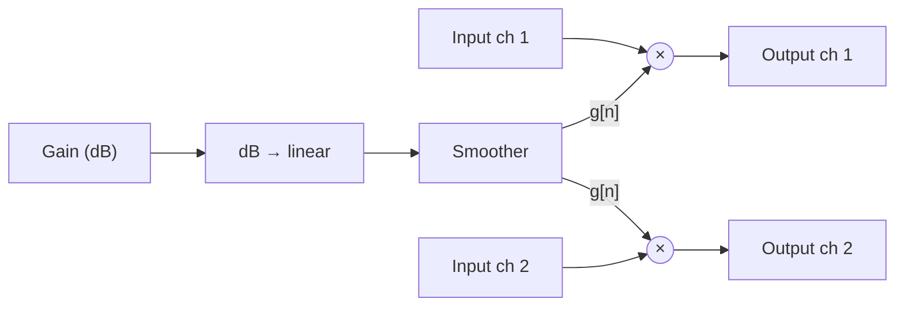

# Gain

## Purpose

Acts as an ideal amplifier or attenuator: the amplitude is multiplied by a constant factor, so the level shifts by the set number of dB at all frequencies without changing the shape of the waveform.

## Reference

None. Phase 0 does not apply to Session 0b.

## Signal flow

Each channel is scaled by the same g[n]; no mixing between channels, no wet/dry, no feedback. Mono uses channel 1 only.

## Parameters

| Name | Range     | Default | Unit | Scaling (linear/log) | Smoothed?                    |
| ---- | --------- | ------- | ---- | -------------------- | ---------------------------- |
| Gain | −60 … +12 | 0       | dB   | linear in dB         | yes, linear ramp in g, 20 ms |

## DSP

- Difference equation: y[n] = g[n] · x[n]; with a settled parameter H(z) = g
- Mapping: g = 10^(L/20); on every change, g[n] ramps linearly to the new g over 20 ms
- Stability: always stable (no feedback)
- Expected values: an impulse comes out as g at sample 0 and 0 elsewhere, on every channel; checked at −60, 0, and +12 dB with a relative tolerance of 1e-6. Magnitude L dB at all frequencies, phase 0; no sweep test.
- State: one smoother shared by all channels, reset to the current g on prepare and reset
- Latency: 0 samples. Tail: 0 s.

## Edge cases

- Above 0 dBFS (e.g. at +12 dB): the plugin does not clip; limiting is left to the host.
- Loading a state sets g to the stored value without a ramp.

## Acceptance

- Build, tests, and pluginval pass; CI is green
- Measured impulse response matches the expected values in this spec (bit-exact)
- Plugin loads in AudioPluginHost, the editor opens, and audio passes through audibly unchanged
- No clicks when parameters move: not applicable (no parameters)

## Acceptance

- Build, tests, and pluginval pass; CI is green
- Measured impulse response matches the expected values in DSP within the stated tolerance
- In AudioPluginHost the Gain parameter is adjustable in dB and changes the level audibly
- No clicks when the gain moves (listening test with `sine-1k-18dBFS.wav`)
