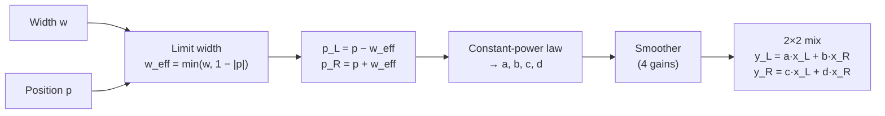

# Stereo Pan

## Purpose

Moves the image[^image] of a stereo signal between the left and right speaker: each output channel is a weighted sum of both input channels, so content from either input can be placed on either side. The weights follow a constant-power law, so each input channel keeps its total power at every pan position and only its perceived direction changes.

[^image]: The stereo image is the left-to-right placement of sound sources that a listener perceives between two speakers, created only by level and timing differences between the channels.

Theory and design choices: [stereo-panning.md](../../docs/stereo-panning.md).

## Reference

None. Phase 0 does not apply to Session 0b.

## Signal flow

No wet/dry, no feedback.

## Parameters

| Name         | Range   | Default | Unit                                 | Scaling (linear/log) | Smoothed?                             |
| ------------ | ------- | ------- | ------------------------------------ | -------------------- | ------------------------------------- |
| Width (w)    | 0 … 1   | 1       | none, shown as 0 … 100 %             | linear               | yes, linear ramp in a, b, c, d, 20 ms |
| Position (p) | −1 … +1 | 0       | none, shown as 100 % L … C … 100 % R | linear               | yes, linear ramp in a, b, c, d, 20 ms |

## DSP

### Difference equation

$$\begin{bmatrix} y_L[n] \\ y_R[n] \end{bmatrix} = \begin{bmatrix} a[n] & b[n] \\ c[n] & d[n] \end{bmatrix} \begin{bmatrix} x_L[n] \\ x_R[n] \end{bmatrix}$$

Memoryless, no feedback, always stable. With settled parameters: frequency-independent, phase 0. Latency 0 samples, tail 0 s.

### Gain mapping

$$w_\text{eff} = \min(w,\, 1 - |p|), \qquad p_{L,R} = p \mp w_\text{eff}, \qquad \theta_{L,R} = \tfrac{\pi}{4}(p_{L,R} + 1)$$

$$a = \cos\theta_L, \quad c = \sin\theta_L, \qquad b = \cos\theta_R, \quad d = \sin\theta_R$$

### Smoothing

On every parameter change, $a, b, c, d$ ramp linearly from their current values to the new targets over $N = \operatorname{round}(T \cdot f_s)$ samples, with $T = 20$ ms and sample rate $f_s$ in Hz. On prepare and reset they are set to their targets without a ramp.

### Measurement

Settled gains, impulse into one input at a time: left gives $y_L[0] = a$, $y_R[0] = c$; right gives $y_L[0] = b$, $y_R[0] = d$; all other samples 0. Absolute tolerance $10^{-6}$. No sweep test.

| $w$ | $p$ | $a$       | $b$       | $c$       | $d$       |
| --- | --- | --------- | --------- | --------- | --------- |
| 1   | 0   | 1         | 0         | 0         | 1         |
| 0.5 | 0   | 0.9238795 | 0.3826834 | 0.3826834 | 0.9238795 |
| 0   | 0   | 0.7071068 | 0.7071068 | 0.7071068 | 0.7071068 |
| 1   | 0.5 | 0.7071068 | 0         | 0.7071068 | 1         |
| 1   | 1   | 0         | 0         | 1         | 1         |
| 1   | −1  | 1         | 1         | 0         | 0         |

## Edge cases

- Parameter change during a ramp: the new ramp starts from the current gains.
- Output does not depend on the block size (1 sample up to the maximum).
- Sample-rate change: $N$ is recomputed on prepare.
- Loading a state sets the gains without a ramp.
- Correlated inputs on one side can reach +6 dB; the plugin does not clip.
- Only stereo in, stereo out; other layouts are rejected.

## Acceptance

- Build, tests, and pluginval pass; CI is green
- Measured impulse responses match the expected values in this spec within the stated tolerance
- In AudioPluginHost, Position audibly moves the image and Width audibly narrows it
- No clicks when Width or Position move
